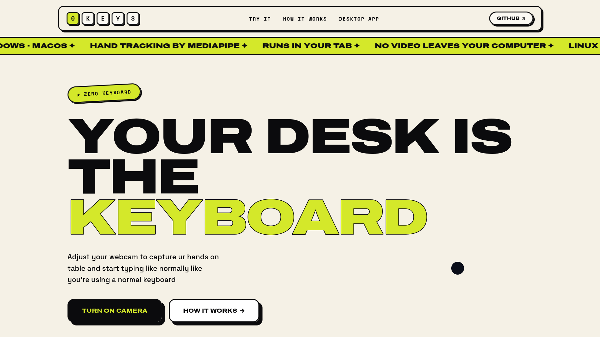
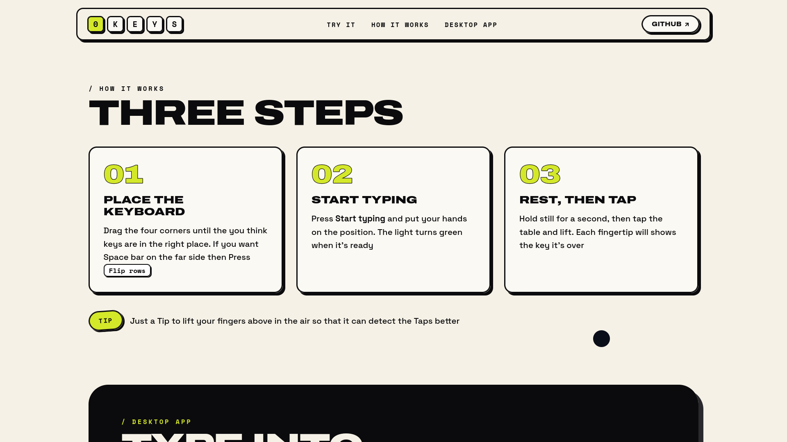

# 0Keys

**Made the First Real Invisible Keyboard**

Zero Keys uses your camera to watch your hands. Tap your fingers on the table like there's a
keyboard there, and the letters show up in any app you're using

**[Try it in your browser](https://lilithcode.github.io/0Keys)**





>  0Keys is an research Based project. I wanted to see how real can we make a invisible Keyboard


---

## What you need

- A computer with **Linux, Windows or macOS**
- **Python 3.10 to 3.12** (3.12 is best)
- A **camera that looks down at your hands** on the table, such as:
  - an Android phone propped up above the desk (works best)
  - a USB webcam pointing down
  - your laptop webcam with the screen tilted forward

---

## Install

**Linux or macOS:** open a terminal in the project folder and run

```bash
./install.sh
```

Add `--autostart` if you want 0Keys to open when you log in.

**Windows:** right click `install.ps1` and choose **Run with PowerShell**. Or run:

```powershell
powershell -ExecutionPolicy Bypass -File install.ps1
```

Add `-Autostart` if you want 0Keys to open when you log in.

The installer sets up everything and adds **0Keys** to your app menu.


---

## Set it up (takes about 2 minutes)

**1. Open 0Keys.** Use your app menu, or run `./0keys` (`0keys.bat` on Windows). A small
control panel appears

**2. Point the camera at the table.** It should see your **whole hands, including your
wrists**. If it only sees your face or your fingertips, it won't work

**3. Place the keyboard.** Click **Set up keyboard / train...**. You'll see the camera
picture with a keyboard drawn on top.

- Drag the **four green corners** so the keys sit under your fingers.
- Space bar on the wrong side? Press **F** to flip it.
- Picture sideways or mirrored? Press **[** or **]** to rotate, **M** to mirror.
- Try a few taps, then press **Q** to close. Your layout saves by itself.

(You only need to do this again if you move the camera)

---

## Typing

1. Click into the app you want to type in.
2. Press **Ctrl + Alt + K**
3. Put your hands on the table. The light goes **amber** (get ready), then **green**
   (typing)
4. Rest your fingers for a second. Then **tap a key and lift**. That's one keypress
5. Press **Ctrl + Alt + K** again to stopp

**Handy to know:**

- **Shift** and **Caps Lock** work like toggles: tap Shift once and the next letter is
  capitalised
- Your **thumbs** only press the space bar
- If no hands are seen for **20 seconds**, 0Keys switches off by itself
- Closing the window just hides it. Use **Quit 0Keys** to really close it


## Use your phone as the camera

A phone above the desk gives the best view. This works on **Linux** with an **Android 12+**
phone over USB

1. Install the tools (Arch Linux): `sudo pacman -S --needed android-tools scrcpy`
2. On the phone, turn on **Developer options** (tap *Build number* 7 times in *About
   phone*), then turn on **USB debugging**
3. Plug in the phone, unlock it and tap **Allow** on the USB debugging prompt
4. Prop the phone so the back camera looks down at the table
5. In the 0Keys panel, choose **Phone over USB** as the camera

Nothing from the phone is saved, and 0Keys cleans up when it closes

---

## Contributions
Contributions and PR are welcomed :)